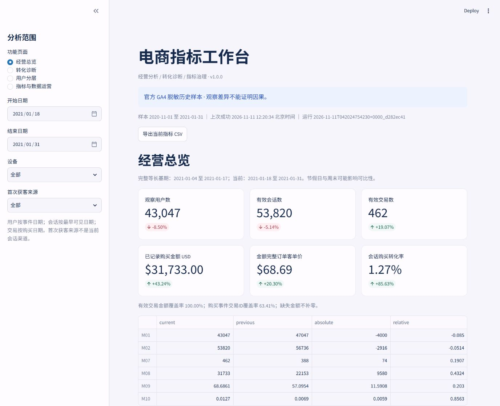

# 电商用户转化分析与指标管理平台

实现版本：v1.0.0。原始需求与验收方案完整保存在 [README.plan.v1.md](README.plan.v1.md)。当前实现包括12项指标、4个Streamlit页面、DuckDB模型、20项质量规则、10条业务验收、3类受控故障和自动报告。正式完成状态以 [发布清单](docs/release_checklist.md) 为准。

**数据边界：正式业务结果必须来自Google官方GA4样本；受控数据只用于技术验收，页面有明显标识，默认不会回退到测试数据。真实试用与讲解录像需要实际完成后登记。**



## 1. 安装

Windows PowerShell，工作目录为本项目根目录：

```powershell
python -m venv .venv
.\.venv\Scripts\python.exe -m pip install -r requirements.txt
```

如果本机 `venv` 的 `ensurepip` 失败，可在已经创建出 `.venv\Scripts\python.exe` 的情况下使用：

```powershell
python -m pip --python .venv install -r requirements.txt
```

macOS/Linux：将 `.\.venv\Scripts\python.exe` 换成 `.venv/bin/python`。配置与Python代码均使用项目相对根目录。UTF-8文本读取，代码注释使用中文。

## 2. 官方真实数据与完整流程

数据源为 `bigquery-public-data.ga4_obfuscated_sample_ecommerce.events_*`，官方范围2020-11-01至2021-01-31；有脱敏与内部一致性限制，不能与在线GA演示账户对账。

本机授权流程见 [真实数据接入](docs/real_data_setup.md)。也支持网页Cloud Shell：上传根目录的 `ga4_cloud_export.py`，先预估，再导出并下载。每个日期独立保存，完整分区可恢复使用：

```bash
pip install --user google-cloud-bigquery
python3 ga4_cloud_export.py --project 你的项目ID
python3 ga4_cloud_export.py --project 你的项目ID --execute
cloudshell download ga4_official_export.zip
```

本地导入（原始压缩包保留）：

```powershell
.\.venv\Scripts\python.exe -m src.import_cloud ga4_official_export.zip
Copy-Item config/settings.example.yml config/settings.local.yml
.\.venv\Scripts\python.exe -m src.pipeline --config config/settings.local.yml
.\.venv\Scripts\python.exe -m src.validation --config config/settings.local.yml
.\.venv\Scripts\python.exe -m src.reporting --output data/official_build
.\.venv\Scripts\python.exe -m pytest --junitxml=reports/controlled/pytest.xml
.\.venv\Scripts\python.exe -m streamlit run app.py
```

按原需求先7天验证时，在Cloud Shell导出命令加 `--end 2020-11-07`，本机配置 `expected_end` 同步改为 `2020-11-07`；通过后扩展完整三个月，再重新运行后续步骤。`src.extract` 是本机ADC可用时的直接提取入口；默认只预估扫描量，加 `--execute` 才下载。

流程：需求与口径 → 官方导出快照 → 标准化事件 → 会话/交易/商品 → 质量检查 → 发布指针切换 → 页面/导出/分析 → 故障修复与复验。任何阻断规则失败返回非零，上一成功版本继续可用。应用只读已发布数据，不自动刷新或下载。

## 3. 不依赖云账号的技术验收

以下仅生成固定种子的受控数据，仅用于技术验收，不作为正式业务结论：

```powershell
.\.venv\Scripts\python.exe -m src.make_fixture
.\.venv\Scripts\python.exe -m src.pipeline --config config/settings.demo.yml
.\.venv\Scripts\python.exe -m src.validation --config config/settings.demo.yml
.\.venv\Scripts\python.exe -m src.reporting --output data/demo_build
.\.venv\Scripts\python.exe -m pytest
$env:ECOM_OUTPUT = 'data/demo_build'
.\.venv\Scripts\python.exe -m streamlit run app.py
```

也可执行 `./run_demo.ps1`。回到正式数据时，设置 `$env:ECOM_OUTPUT = 'data/official_build'`。技术测试会保留独立样本和故障证据，不修改官方快照；原始数据不随意去重或删改。

## 4. 产品页面与口径

|页面|主要操作|证据|
|---|---|---|
|经营总览|6项主卡、12项定义、完整等长周期、设备/首次来源筛选、趋势、导出|sql/marts/metrics.sql|
|转化诊断|严格漏斗、两期设备、窗内用户分组、覆盖率及SQL复算|sql/facts/sessions.sql|
|用户分层|窗内无/单次/多次有效交易、人数占比与金额|src/metrics_service.py|
|指标与数据运营|搜索字典、20项质量、缺失与冲突样例、运行日志、问题记录|src/quality.py|

12项指标见 [指标注册表](docs/metric_dictionary.csv)。用户按事件日期，会话按最早可见日期，交易按购买日期。严格漏斗每一步时间必须更晚；同时间戳不猜测先后。M06为含purchase事件的会话，M07为冲突隔离后的有效交易；二者不混用。金额固定USD，缺失不补零，客单价只使用有金额交易。完整细节见 [数据契约](docs/data_contract.md) 和 [数据模型](docs/data_model.md)。

用户设备筛选表示窗内在该设备有事件，跨设备可能重叠；用户分层按当前筛选与观察窗口重算，不称生命周期首购。首次来源不是当前会话来源。P0是本机单用户产品，权限矩阵仅设计，不声明实现鉴权。

## 5. 结果与验收文件

- 正式结果入口：[business_analysis.md](reports/business_analysis.md)、[data_profile.md](reports/data_profile.md)、[quality_report.md](reports/quality_report.md)。官方数据接入前明确标注待完成。
- 正式运行详细产物：`reports/official/`；受控技术运行：`reports/controlled/`。报告含金额对称分解、设备结构与组内转化分解、漏斗及分层，均有SQL、CSV和图表。
- 幂等与故障闭环：相应目录中的 `fault_cases.json`，记录冲突、断档、发布前异常的检查命中、旧版保留和修复复跑。
- 12项指标独立SQL/统一服务/CSV对账：`reconciliation.csv`；质量明细：`quality_results.csv`；性能原始测量：`performance.json`。服务耗时与页面耗时分别报告。
- 自动技术验收：`tests/acceptance/` 的U01—U10；人工可复算语义样本：`tests/quality/`。测试不等于真实用户试用。
- PRD、假设、原型、权限设计、版本、问题、发布清单在 `docs/`。试用记录在 [user_feedback.md](reports/user_feedback.md)，演示脚本在 [demo_script.md](demo/demo_script.md)。

## 6. 未完成项与使用限制

官方快照、真实业务结论、真实试用、完整讲解录像、干净环境复跑与浏览器性能的实际完成状态逐项记录在发布清单，不预先宣称完成。缺少成本与干预实验，不计算利润、ROI或真实转化提升；没有外部试用时明确“用户验证待完成”。D7、RFM、权限后端、口径变更回滚属P1，未实现。

实际样本适配：为避免缺失/冲突交易ID的购买者被误标为未购买，三组按有效交易数命名为“窗内无有效交易、单次有效交易、多次有效交易”，额外显示购买事件用户率与未匹配用户数。原需求的三组互斥与总量核对仍保留。

## 本次实际交付结果

官方GA4样本已下载并完整运行，范围2020-11-01至2021-01-31（92天）。原始事件4,295,584，观察用户270,154，有效会话360,129，有效交易4,888，已记录USD购买金额337,993。不是受控数据的业务结论。

15项自动测试通过；20项质量检查为19通过、1警告；192项筛选对账和实际浏览器CSV的12项指标复算一致；三类异常均完成修复复跑。正式报告在reports/official/，入口为reports/business_analysis.md。详细完成与未完成项目见docs/release_checklist.md。

本地服务默认地址为 http://127.0.0.1:8501 。已有正式数据与发布库时，启动只需执行 `.\.venv\Scripts\python.exe -m streamlit run app.py`，读取本地已发布结果。GitHub 仓库提供代码、小型受控样本及已验证的正式分析报告，不包含官方原始快照、运行数据库、虚拟环境或认证文件；新环境需按第2节接入官方数据，或按第3节运行受控样本验收。

六分钟演示为 `demo/platform_walkthrough.mp4`，使用真实页面截图与运行结果回放，无旁白，非连续录屏。真实用户走查、连续讲解录屏、浏览器冷启动计时待完成；浏览器页面p95为3.249至3.993秒，四页均超过3秒目标，未将其标成达标。

三项真实分析概况：当前14天较前14天有效交易金额增加9,580美元（交易ID覆盖同时下降）；会话购买转化增加0.587个百分点，组内变化贡献占主导；严格路径主要缺口在浏览到加购，且无有效交易组中有228名购买事件用户。各结论的分母、日期、覆盖限制与实验建议均已在报告中展开。
