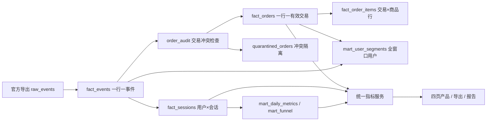

# 模型与关联

主键：事件event_row_id仅表示本次导入位置；会话(user_id,session_id)；交易transaction_id；商品(transaction_id,item_line)。事件关联会话为多对一；交易关联会话为多对一；商品关联交易为多对一。金额始终在订单粒度计算，不能先连接商品后相加。

mart日表支持趋势；周期用户与比率必须由原粒度重算。ops_quality_results记录本次20项结果；每个发布数据库含本次ops_pipeline_runs；跨运行日志在runs.jsonl。发布指针只在全部阻断规则通过后切换。
