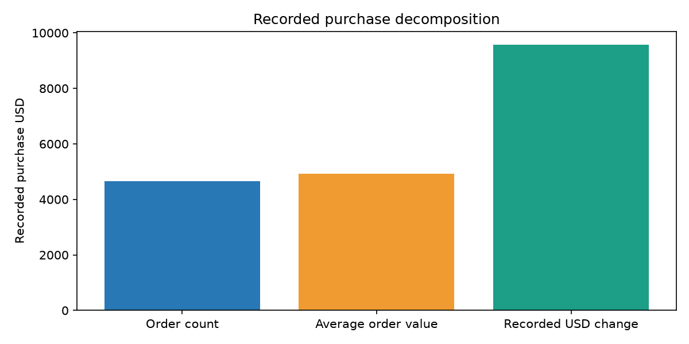
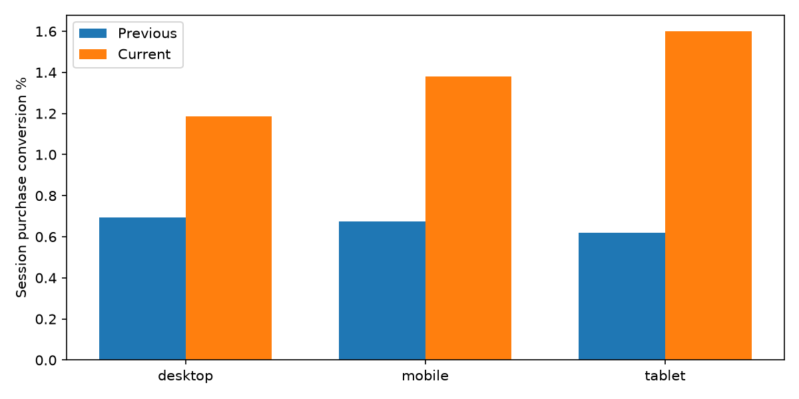
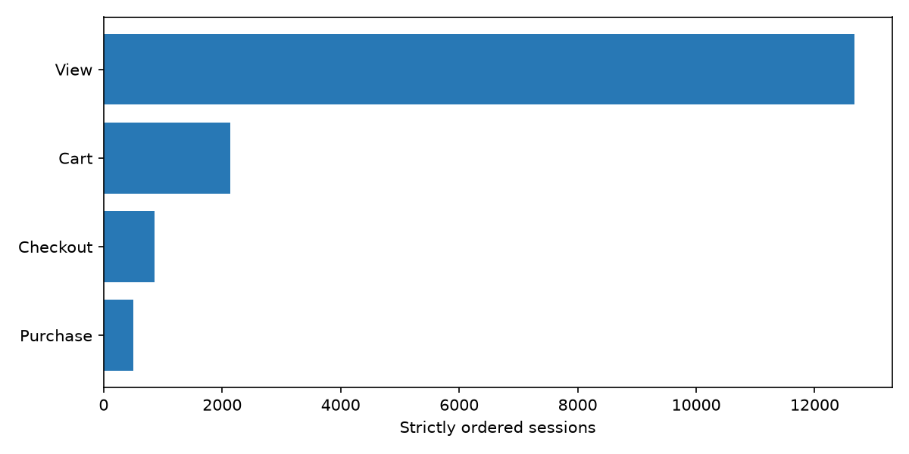

# 三项可复算分析

**官方脱敏历史样本**。运行 2026-11-11T042024754230+0000_d282ec41。完整等长周期：2021-01-04—2021-01-17 对比 2021-01-18—2021-01-31（各14天）。采用末尾两个相邻完整周期，未按差异挑选极端日期；仍需注意节假日与样本边界。

## 1. 已记录金额变化

两期有金额交易 388 → 462；客单价 $57.10 → $68.69；已记录金额 $22153.00 → $31733.00，差额 $9580.00。订单量贡献 $4653.92，客单价贡献 $4926.08；对称分解加回误差 -0.00000000 USD。

有效交易金额覆盖率 100.00% → 100.00%；购买事件交易ID覆盖率 93.40% → 63.41%。分解只用金额完整且未冲突的有效交易，不等于所有购买事件。证据：sql/marts/metrics.sql的M08、M09与amount_orders；amount_decomposition.csv；charts/amount.png。建议先检查缺失ID、冲突隔离与缺失金额是否系统性集中，再判断交易量与单价的运营含义。没有成本、退款验证或实验，不能称利润提升。



## 2. 设备构成与会话转化

会话 56736 → 53820；购买会话转化率 0.69% → 1.27%，变化 +0.587 个百分点。设备结构贡献 -0.001 个百分点，组内转化贡献 +0.588 个百分点；分组覆盖完整=True。有任一期空组时不强行计算其组内转化。

证据：sql/marts/metrics.sql，以device参数逐组复算；device_decomposition.csv，保留未知与小样本标记；charts/device.png。建议先核验各设备购买埋点与流量结构，再对主要流量设备设计结账体验实验；观察差异不等于设备导致转化变化。



## 3. 路径损失与窗内用户

当前严格漏斗会话：[12671.0, 2135.0, 859.0, 503.0]。最大绝对损失出现在进入 Cart，损失 10536 个会话。顺序不确定 1297/53820；有purchase事件但未完成闭合路径 182/685。

当前窗内用户分组如下，合计43047人。“无有效交易”中仍可能有购买事件，不能称为确定未购买人群：
```csv
segment,users,orders,recorded_usd,purchase_event_users,unmatched_purchase_users

窗内单次有效交易,421,421,30032.0,421,0

窗内多次有效交易,12,41,1701.0,12,0

窗内无有效交易,42614,0,,228,228

```

证据：sql/facts/sessions.sql（每步严格晚于前一步），sql/marts/metrics.sql（闭合阶段），funnel.csv与segments.csv；charts/funnel.png。用户分组按当前窗口重算且互斥；不称生命周期首购。这里的损失是样本记录中的路径缺口，不能直接解释为真实用户流失或体验问题；应先排查加购埋点稀疏、路径缺失和并列时间戳，再设计实验并记录样本、分流与核心转化率。



## 复算方法与边界

python -m src.reporting --output data/official_build。页面、导出、报告调用同一服务；reconciliation.csv附当前全区间12指标及独立SQL核验。报告生成时间 2026-11-11T04:34:17.351197+00:00。脱敏数据有限一致性；真实干预、企业收益、用户试用改善均未验证。
