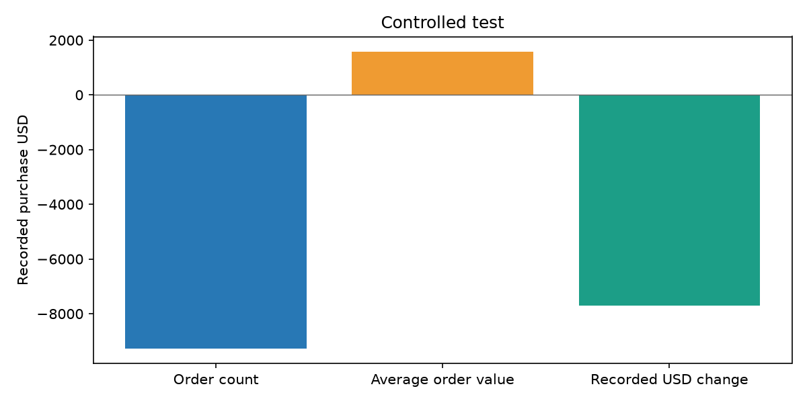
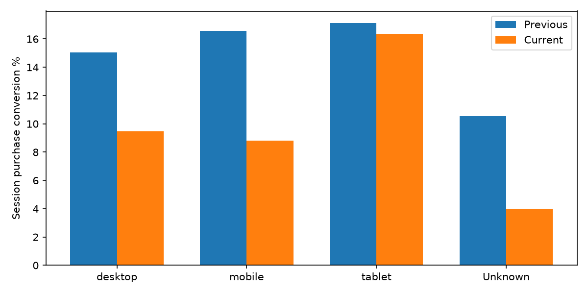
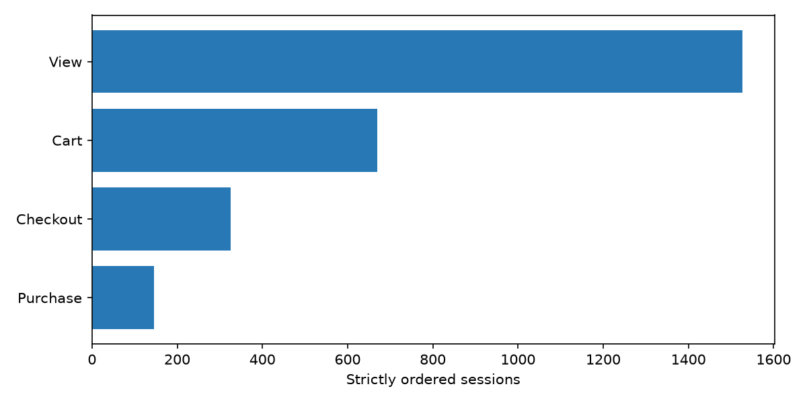

# 三项可复算分析

**受控测试数据；下列数值仅验证分析程序，不是实际业务发现**。运行 2026-11-11T032744977344+0000_93ca9c24。完整等长周期：2020-11-01—2020-11-14 对比 2020-11-15—2020-11-28（各14天）。采用末尾两个相邻完整周期，未按差异挑选极端日期；仍需注意节假日与样本边界。

## 1. 已记录金额变化

两期有金额交易 235 → 142；客单价 $95.60 → $104.02；已记录金额 $22465.64 → $14770.75，差额 $-7694.89。订单量贡献 $-9282.23，客单价贡献 $1587.34；对称分解加回误差 0.00000000 USD。

金额覆盖率 97.92% → 97.26%；分解只用金额完整交易。证据：sql/marts/metrics.sql的M08、M09与amount_orders；amount_decomposition.csv；charts/amount.png。建议先检查缺失金额交易是否系统性集中，再判断交易量与单价的运营含义。没有成本、退款验证或实验，不能称利润提升。

## 2. 设备构成与会话转化

会话 1528 → 1526；购买会话转化率 15.71% → 9.57%，变化 -6.139 个百分点。设备结构贡献 +0.033 个百分点，组内转化贡献 -6.172 个百分点；分组覆盖完整=True。有任一期空组时不强行计算其组内转化。

证据：sql/marts/metrics.sql，以device参数逐组复算；device_decomposition.csv，保留未知与小样本标记；charts/device.png。建议先核验各设备购买埋点与流量结构，再对主要流量设备设计结账体验实验；观察差异不等于设备导致转化变化。

## 3. 路径损失与窗内用户

当前严格漏斗会话：[1526.0, 669.0, 326.0, 146.0]。最大绝对损失出现在进入 Cart，损失 857 个会话。顺序不确定 0/1526；有可识别购买但未完成闭合路径 0/146。

证据：sql/facts/sessions.sql（每步严格晚于前一步），sql/marts/metrics.sql（闭合阶段），funnel.csv与segments.csv；charts/funnel.png。用户分组按当前窗口重算且互斥；不称生命周期首购。建议先排查路径缺失和并列时间戳，再根据主要损失阶段设计商品详情或加购流程实验，记录实验样本、分流与核心转化率。

## 复算方法与边界

python -m src.reporting --output data/demo_build。页面、导出、报告调用同一服务；reconciliation.csv附当前全区间12指标及独立SQL核验。报告生成时间 2026-11-11T03:27:52.972525+00:00。脱敏数据有限一致性；真实干预、企业收益、用户试用改善均未验证。
